# actp-sheaf-cohomology

**Sheaf-theoretic checks for protocol state machines.** Describe a protocol as states and transitions in YAML, and ask two questions of it:

1. **Do all routes agree?** If two routes through the protocol reach the same state, do they compute the same promised quantities (payout, fee, what is left in escrow)?
2. **Are fields carried consistently?** Is a field that the protocol starts with still present where it is expected?

The repository is also the reproducibility artifact for the paper *Sheaf Cohomology for Settlement Protocol Verification* (Rooschüz and Mujić, 2026). The paper is being revised; see [Status](#status).

<picture>
  <source media="(prefers-reduced-motion: reduce) and (prefers-color-scheme: dark)" srcset="docs/assets/route-agreement-dark-static.svg">
  <source media="(prefers-reduced-motion: reduce)" srcset="docs/assets/route-agreement-light-static.svg">
  <source media="(prefers-color-scheme: dark)" srcset="docs/assets/route-agreement-dark.svg">
  
</picture>

## Quick start

```bash
pip install -r requirements.txt        # numpy, pyyaml
python3 -m pytest tests/ -q            # 53 passed

# 1. Route agreement on a toy escrow, and on the same escrow with a seeded defect
python3 route_agreement.py --config models/toy_fee_routes.yaml
python3 route_agreement.py --config models/toy_fee_routes_leaky.yaml

# 2. Field consistency on the ACTP lifecycle model
python3 h1_lint.py --config protocol.yaml --2complex --field-loss
```

## 1. Route agreement

`route_agreement.py` builds a cellular sheaf whose maps carry the accounting: each transition says how every promised quantity is computed from the quantities before it.

**Theorem.** The global sections of this sheaf are exactly the starting values on which every pair of routes to the same state agree. So `dim H⁰` equals the number of free parameters if and only if the protocol's accounting does not depend on the route taken. The proof, a reduction to one check per loop, and the limits are in [ROUTE_AGREEMENT.md](ROUTE_AGREEMENT.md).

A toy escrow promises a 1% fee whether a delivery is settled directly or after a dispute. With a seeded defect (the dispute route collects half the fee) the tool names the two routes and the quantity:

```text
$ python3 route_agreement.py --config models/toy_fee_routes_leaky.yaml
model: toy escrow, dispute route under-collects the fee   initial state: COMMITTED
free parameters (dim V_r) = 1   dim H^0 = 0   dim H^1 = 1
ROUTES DISAGREE on 1 parameter direction(s):
  at SETTLED: route deliver > settle
       versus route deliver > dispute > uphold_provider
    fee: second route minus first = (-1/200)*amount
```

Exit code 0 means the routes agree, 1 means they disagree, 2 means the model is malformed or outside the theorem's scope. All arithmetic is exact (rational numbers).

A model looks like this:

```yaml
initial: COMMITTED
states:
  COMMITTED: {quantities: [amount]}
  SETTLED:   {quantities: [paid_out, fee]}
transitions:
  - name: settle
    from: COMMITTED
    to: SETTLED
    map:                          # target quantity <- linear form in source quantities
      paid_out: {amount: 1}
      fee:      {amount: 1/100}
views:                            # optional: who can observe which quantities
  platform: [fee]
```

With `views`, each finding also says which participants can and cannot see the disagreement in their own quantities.

**The modelling rule.** Put in a state only the quantities the protocol promises are determined by that state alone. A value that legitimately differs by route, such as a dispute split, must be a named free quantity where it is chosen.

## 2. Field consistency (the H¹ linter)

`h1_lint.py` models each state by the list of fields it holds and each transition by the fields both ends share.

```bash
python3 h1_lint.py --config protocol.yaml              # 1-complex, per-subgraph breakdown
python3 h1_lint.py --config protocol.yaml --2complex   # with faces over parallel routes
python3 h1_lint.py --config protocol.yaml --field-loss # list each missing (state, field) pair
```

It reports two different things, and they should not be confused:

| Output | What it measures | What it does not measure |
|---|---|---|
| `H¹` (1-complex and 2-complex) | Loops in each field's support graph. Useful for comparing two versions of a model. | Lost data. Restoring a dropped field can raise it; a drop with no loop scores 0. |
| `field_loss` score | The number of (state, field) pairs where a field is expected, because a path from an initial state that holds it reaches the state with no declared drop, and is absent. | Anything about contract storage: the field lists are an abstraction. |

In the default mode, adding a field to a non-initial state never raises the `field_loss` score. Details of the YAML schema (`carries`, `drops`, `initial`, `paths`, `faces`) are in [H1_LINTER_SPEC.md](H1_LINTER_SPEC.md).

## What these tools cannot tell you

- **Who is allowed to act.** Two escrows that differ only in who may release the funds get the same answer from both tools. Authorisation needs a model checker or a contract verifier.
- **Anything about code the model does not describe.** Both tools check the YAML model. A model should be tied to its contract by at least one measured execution.
- **Non-linear accounting.** Route agreement handles linear maps. A fee with a minimum or a cap needs a model per region; this is not implemented.

## Reproducing the paper

Every figure in the paper is reproduced from `protocol_paper_v1.yaml`, which is byte-identical to the model the paper used. Full recipe: [REPRODUCING.md](REPRODUCING.md).

```bash
python3 h1_lint.py --config protocol_paper_v1.yaml --2complex   # H¹ = 24 (graph), 0 (2-complex), H² = 20, 10 faces
python3 verify_rational.py                                      # exact cross-check, exit 0
python3 participant_semantic_h1.py                              # Section 5 table: 6, 7, 7, 7, 8, 7, 8, 6
```

`protocol.yaml` is the current model. It adds the `DISPUTED → CANCELLED` transition, so its numbers differ: H¹ = 28 on the graph, 0 on the 2-complex, H² = 20, 11 faces.

## Status

The paper as first written overstates what its H¹ numbers mean. Two reviews in October and November 2026 established that the graph H¹ counts loops per field, and that H¹ = 0 on the 2-complex follows from how the faces are chosen. `REVIEW_CHANGES.md` records each finding and its fix. The route-agreement construction is the basis of a revision in which the cohomology depends on the protocol's own arithmetic. Until that revision is published, cite the tools, not the paper's interpretation of its figures.

## Files

| File | Purpose |
|---|---|
| `route_agreement.py` | Route-agreement engine and command line |
| `ROUTE_AGREEMENT.md` | Theorem, proof, worked example, limits |
| `models/` | Route-agreement models |
| `h1_engine.py`, `h1_lint.py` | Field-consistency engine and linter |
| `H1_LINTER_SPEC.md` | Linter contract and YAML schema |
| `protocol.yaml` | Current ACTP lifecycle model (field lists) |
| `protocol_paper_v1.yaml` | The paper's model; reproduces its figures |
| `verify_rational.py` | Exact rational cross-check of the linter's ranks |
| `participant_h1.py`, `participant_semantic_h1.py` | The paper's participant supplements |
| `toy_escrow_protocol.yaml`, `toy_escrow_broken.yaml` | Toy models for the linter |
| `actp_sheaf.py` | Original archival implementation |
| `tests/` | 53 tests, including a 600-model random check of the theorem |
| `REPRODUCING.md`, `REVIEW_CHANGES.md` | Reproduction recipe; review record |

## Citation

```bibtex
@misc{rooschuz2026sheaf,
  title  = {Sheaf Cohomology for Settlement Protocol Verification},
  author = {Roosch\"{u}z, Justin and Muji\'{c}, Damir},
  year   = {2026},
  note   = {AGIRAILS Inc.}
}
```

A machine-readable [CITATION.cff](CITATION.cff) is provided.

## License

Apache-2.0. See [LICENSE](LICENSE).
